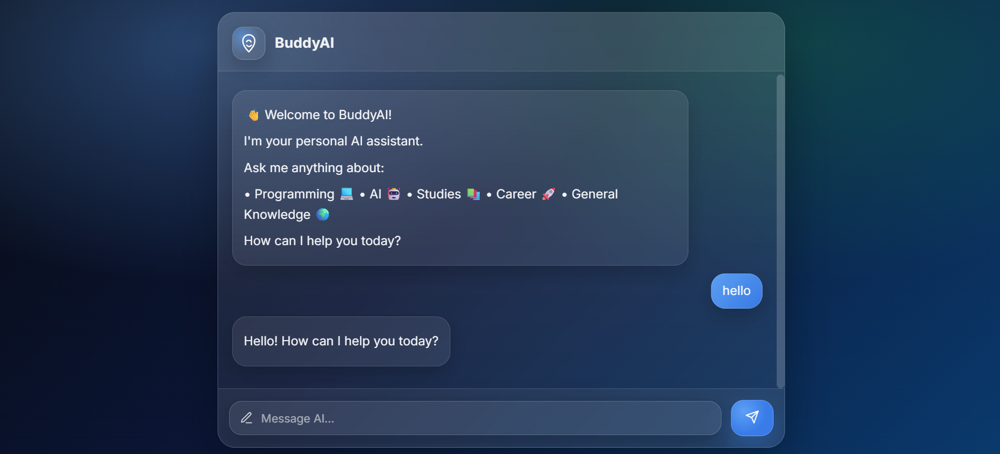

# 🤖 BuddyAI

BuddyAI is an AI-powered chatbot built using **HTML, CSS, JavaScript, Python (FastAPI), and Google Gemini API**. It provides real-time conversational responses through a clean, responsive, and user-friendly interface.

The project demonstrates how a modern frontend can securely communicate with a Python backend to interact with a Large Language Model (LLM) while keeping API keys protected.

---

## ✨ Features

- 🤖 AI-powered conversations using Google Gemini
- 💬 Real-time chatbot interface
- 🔒 Secure FastAPI backend with environment variables
- 📝 Markdown support for AI responses
- ⚡ Typing indicator for better user experience
- 📱 Responsive and minimal UI

---

## 🛠️ Tech Stack

**Frontend**
- HTML
- CSS
- JavaScript

**Backend**
- Python
- FastAPI

**AI Model**
- Google Gemini API

---

## 📸 Preview

---

## 🚀 Future Improvements

- Conversation memory
- Streaming responses
- Code syntax highlighting
- File upload support
- Multiple chat sessions
- Voice interaction

---

## 👨‍💻 Author

**Krishankant Singodia**

Final Year B.Tech (Mechanical Engineering)  
National Institute of Technology Patna

---
